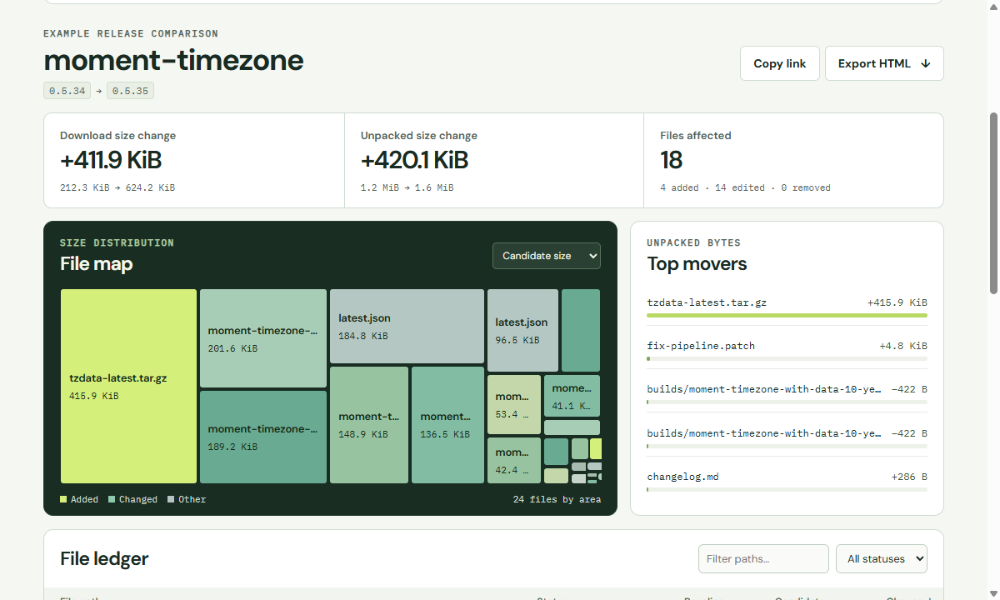

# Tarball Atlas

**See which files made an npm release bigger, and catch packaging mistakes before you publish.**

[Open the explorer](https://hakm12-ship-it.github.io/tarball-atlas/) · [Download the offline viewer](https://github.com/hakm12-ship-it/tarball-atlas/releases/download/v1.0.0/atlas.html) · [한국어](README.ko.md)

An extra archive slipped into `moment-timezone@0.5.35`. The download grew from **217,410 to 639,171 bytes** in a single patch. Click the lime rectangle in the example to see the exact file and digest. One file accounts for 425,833 of the 430,155 extra unpacked bytes. [Compare the releases](https://hakm12-ship-it.github.io/tarball-atlas/) · [Upstream fix](https://github.com/moment/moment-timezone/pull/1000)

[](https://hakm12-ship-it.github.io/tarball-atlas/)

## Try it on your package

- **Two published releases.** Enter a package name and an exact version or dist-tag in each box. The explorer fetches the actual tarballs from the public npm registry. **Copy link** creates a comparison pinned to the resolved versions. [Try a different pair with Preact](https://hakm12-ship-it.github.io/tarball-atlas/?from=preact%4010.24.1&to=preact%4010.24.2)
- **A release candidate.** Under **Local files**, choose **Published baseline**, enter the previous release and select your freshly built `.tgz`. You can also load two local archives or snapshots. Local inputs are processed in the browser.
- **An offline review.** Choose **Export HTML** and send the resulting file to a teammate. It includes the interactive map, searchable ledger, package paths, sizes, available hashes and any Git tracking metadata in the snapshots. Everything needed to open the report is embedded. [Get the standalone viewer](https://github.com/hakm12-ship-it/tarball-atlas/releases/download/v1.0.0/atlas.html)

The map can show candidate size, baseline size or absolute change. Click a rectangle, a top mover or a ledger row to inspect its before/after bytes and SHA-256 digests. “Download size” measures the whole compressed archive. Individual file changes use unpacked bytes. Same-length files are marked *unverified* when a digest is missing.

## Command line

The release CLI runs on Node.js 22+ and has zero runtime dependencies. This command installs the versioned package from GitHub Releases.

```sh
npm install --global https://github.com/hakm12-ship-it/tarball-atlas/releases/download/v1.0.0/tarball-atlas-1.0.0.tgz
tarball-atlas diff npm:moment-timezone@0.5.34 npm:moment-timezone@0.5.35 --html report.html
```

Compare a public release directly with a local tarball or snapshot. The `npm:` prefix tells the CLI to contact the public registry. Local-to-local comparisons work offline.

```sh
tarball-atlas diff npm:my-package@1.2.0 ./my-package-1.3.0.tgz
tarball-atlas diff before.json after.json --json
```

### Check the next publish

Run your normal build first if it creates release files. From the package directory, create a snapshot outside the package tree so it stays out of the dry run.

```sh
tarball-atlas scan .
tarball-atlas scan . --json > ../candidate.json
tarball-atlas scan . --require dist/index.js --forbid "**/*.map" --max-unpacked 500000
```

`scan` asks your installed npm for its dry-run pack list with lifecycle scripts disabled. It also shows packed files outside Git and tracked files omitted from the package. Generated files can legitimately appear in either list. For projects with a `prepare` hook, use npm 11 or newer. [npm changelog](https://docs.npmjs.com/cli/v11/using-npm/changelog/#1100-pre0-2024-11-26)

Repeat `--require` for exact package-relative paths and `--forbid` for patterns. Use `*` and `?` within a path segment and `**` for zero or more segments. The size limit counts total unpacked file bytes. The CLI exits with `0` on success, `1` for a failed gate and `2` for input or tool errors.

### GitHub Actions

Add this step after checkout, Node setup and any build that produces your published files.

```yaml
- uses: hakm12-ship-it/tarball-atlas@v1.0.0
  with:
    require: |
      dist/index.js
      package.json
    forbid: |
      **/*.map
    max-unpacked: '500000'
```

The action reads the package and reports gate failures in the job summary. It supports package directories within monorepos. [Complete workflow](docs/ci-example.md)

## Formats and limits

| Input | What you can compare |
| --- | --- |
| npm spec | Actual published bytes from the public registry. Supports scoped names, exact versions and dist-tags. |
| Local npm `.tgz` | Actual bytes, unpacked in memory. Supports regular files and directories, including long PAX/GNU paths. |
| Atlas snapshot | Package metadata, paths, sizes, available SHA-256 digests, and Git tracking when available. |
| `npm pack --dry-run --json` | Membership, sizes and available archive metadata. Equal sizes alone leave the content comparison unverified. |

Archive limits are 64 MiB compressed, 256 MiB expanded, 96 MiB per file and 25,000 tar entries. The treemap groups the long tail after 63 tiles. The ledger includes every accepted file. The web application has no backend, analytics or account system. Opening a registry comparison requests the selected packages from npm.

## Develop

```sh
git clone https://github.com/hakm12-ship-it/tarball-atlas.git
cd tarball-atlas
npm ci
npm run build
npm test
```

Open `offline/atlas.html` directly or serve `dist/site/` on localhost. The build uses esbuild to produce the single-file viewer. The CLI and hosted explorer share the comparison model. [Example provenance](docs/examples/README.md) · [MIT license](LICENSE)
